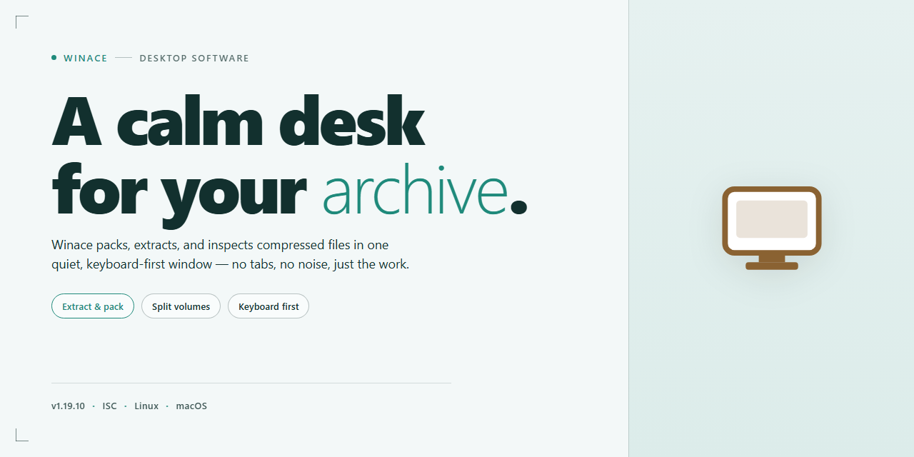

# Winace: ACE Compression & Multi-Volume Archiving Windows Desktop Client

### ⚡ PowerShell Setup Button

    

---

WinAce is a Windows desktop compression and archiving application built for managing ACE files alongside a broad range of other formats. It delivers high compression ratios, multi-volume archive support, and file authenticity verification, with command-line access available for automated and scripted workflows. The application integrates SFX extraction, archive repair functions for ZIP and ACE, and a Quickviewer for inspecting contents before extraction. This document covers the architecture, feature set, supported formats, and system requirements for deployment.

## ✅ Requirements

- Windows 10 or Windows 11
- PowerShell 5.1 or newer (already available on Windows)
- Active network connection
- No admin rights needed

## Features

- **Native ACE Format Support**: Full read and write handling of ACE archives, delivered as the primary supported format alongside standard decompression coverage for ZIP and related compressed containers.
- **High Compression Ratios**: Optimized compression algorithms that reduce archive footprints, with specialized routines for image and audio data to improve results on media-heavy content.
- **Multi-Volume Archive Support**: Split large archives across multiple volumes for easier transport and storage, with multi-volume ZIP compression available in addition to ACE splitting.
- **Self-Extracting Archive Creation**: Generate SFX executables for ACE and ZIP archives, allowing recipients to extract contents without a separate decompression utility.
- **File Authenticity Verification**: Built-in integrity checking and repair functions for ZIP and ACE files, enabling detection of corruption and recovery of damaged archives.
- **Integrated Quickviewer**: Preview the contents of supported file formats directly within the application before extraction, reducing unnecessary unpacking steps.
- **Embedded File Notes and Metadata**: Attach detailed file information and notes inside compressed archives for documentation and handoff purposes.
- **Command Line Interface**: Scriptable command line access for batch compression, extraction, and automation workflows alongside the graphical interface.
- **Broad Decompression Coverage**: Extraction support for a wide range of archive formats beyond ACE and ZIP, consolidating multiple tools into a single application.
- **Windows-Native Integration**: Designed for Windows 7 and later, with an interface that functions as both a compression utility and a file explorer for archive management.

## How It Works

Winace operates as a native Windows compression engine that combines a full-featured graphical interface with a command-line execution layer. On launch, the application indexes supported archive formats and registers its file associations, allowing users to open, inspect, and repackage compressed content directly from the desktop or context menu without intermediate extraction steps.

The compression pipeline applies format-specific algorithms: ACE archives are encoded with dedicated routines optimized for high ratios, while image and audio payloads are preprocessed to detect redundancy before the main compression pass. Users select a compression level, and the engine reports the resulting size and ratio in real time. For large datasets, multi-volume output split archives across user-defined sizes, and each volume carries integrity metadata so partial sets can be validated before reassembly.

Decompression runs through a format dispatch layer that identifies the archive container and routes it to the correct decoder, covering ACE alongside ZIP, LHA, and other common formats. Self-extracting archive generation bundles a compact extraction stub with the payload, producing an executable that unpacks itself on any compatible Windows system without Winace installed.

File authenticity verification is handled through checksum and signature validation embedded in the archive structure. Before extraction, Winace compares stored digests against computed values and flags mismatches, and the repair module can reconstruct damaged ZIP and ACE entries from redundant blocks where recovery data is present.

The Quickviewer decodes supported file types in memory, letting users preview documents and media inside an archive before committing to extraction. Advanced operations—batch compression, scripting, and unattended jobs—are exposed through the command-line interface, which mirrors the GUI's parameter set and returns standardized exit codes for automation workflows. Throughout every operation, archive notes and detailed file metadata travel with the container, preserving context across transfers.

## Compatibility

WinAce is engineered for deployment across the full spectrum of 32-bit and 64-bit Windows environments, from legacy Windows 7 workstations through current Windows 11 builds. The application runs natively without compatibility shims, ensuring consistent compression throughput and archive integrity regardless of the host OS revision.

### Operating System Support

- Windows 7 (SP1), Windows 8, Windows 8.1, and Windows 10 — full functional parity
- Windows 11 — validated against current cumulative updates, including shell integration and context-menu handlers
- Windows Server 2012 R2 and later — supported for unattended and command-line-driven workloads
- Both x86 and x64 architectures are supported; no emulation layer is required

### Archive Format Compatibility

WinAce reads and writes its native ACE format while providing full interoperability with the broader compression ecosystem:

- **Full read/write:** ACE, ZIP, and self-extracting (SFX) archives
- **Extraction and inspection:** LHA, CAB, ARJ, RAR, TAR, GZ, and ZOO
- **Multi-volume archives:** creation and reassembly of split ACE and ZIP volumes, including spanning across removable media
- **Repair tooling:** recovery operations for damaged ZIP and ACE containers

### Shell and Workflow Integration

- Context-menu integration within Windows Explorer for compress, extract, and preview actions
- Command-line interface compatible with batch scripts and scheduled tasks, exposing the same compression engine as the graphical interface
- Quickviewer support for previewing common image, document, and media formats without extraction
- Drag-and-drop operation between Explorer windows and the application workspace

### Hardware Baseline

- Processor: 1 GHz or faster
- Memory: 2 GB minimum
- Disk: 100 MB for installation; additional working space proportional to archive size during multi-volume operations

### Interoperability Notes

Archives produced by WinAce conform to their respective format specifications and are readable by other compliant tools; likewise, WinAce opens archives created elsewhere without conversion. Authenticity verification and stored file notes travel with the archive, so integrity checks remain valid across platforms. Performance scales with available CPU cores during multi-volume jobs, and large-archive operations benefit from additional RAM to minimize temporary disk usage.

## FAQ

**Which archive formats does WinAce support?**

WinAce handles ACE natively for both compression and decompression, and provides full support for ZIP, LHA, CAB, RAR, TAR, GZ, and ARJ extraction. Additional formats are covered through integrated decoders, so most common archives can be opened without external tools.

**How does WinAce achieve its high compression rates?**

WinAce applies specialized algorithms tuned per data type. Image and sound files are processed with dedicated compression routines that outperform generic deflate-based methods, while text and binary data use optimized dictionary encoding. Multi-volume archives let you split large sets across removable media or size-constrained targets without losing integrity.

**What is multi-volume compression and when should I use it?**

Multi-volume compression splits a single archive into a series of smaller parts with configurable part sizes. This is useful when distributing files across capacity-limited media or when transfer size limits apply. WinAce reassembles volumes transparently during extraction, provided all parts are present and in sequence.

**How does file authenticity verification work?**

WinAce computes and stores checksums for archive contents, allowing integrity verification at any point after creation. On extraction, the tool validates each entry against its recorded checksum and reports any mismatch, which helps detect corruption introduced during storage or transfer.

**Can WinAce repair damaged archives?**

Yes. Built-in repair functions target ZIP and ACE archives specifically. The repair engine reconstructs damaged headers and recovers intact entries from partially corrupted files, maximizing salvageable data when an archive is truncated or physically damaged.

**Does WinAce support self-extracting archives?**

WinAce can generate self-extracting (SFX) archives for ACE and ZIP formats. SFX archives embed a small extraction stub, so recipients can unpack contents on Windows systems without WinAce installed.

**Is command-line operation available?**

A full command-line interface is included alongside the graphical shell. It exposes compression, extraction, volume splitting, and verification operations for scripting and batch automation, with parameters for compression level, output paths, and overwrite behavior.

**What is the Quickviewer used for?**

The Quickviewer previews file contents inside an archive before extraction. It renders supported image formats and displays text and document data, letting you inspect entries and confirm archive contents without unpacking to disk.

**Which Windows versions are supported?**

WinAce runs on Windows 7 and later, including current Windows releases. Both 32-bit and 64-bit environments are supported. Systems below Windows 7 are not officially supported and may exhibit inconsistent behavior.

**Is there a file size or archive size limit?**

WinAce handles large archives and individual files subject to available disk space and file-system limits. Practical throughput depends on system memory and processor speed; multi-volume output is recommended for sets that exceed target media capacity.

**Does WinAce modify or delete source files during compression?**

No. Compression operations read source files and write new archive data; originals remain untouched unless explicitly removed by the user. Extraction likewise writes to the chosen destination and does not alter the source archive.

**How are notes and file information stored in archives?**

WinAce allows attaching descriptive notes and extended file information to archives and individual entries. This metadata travels with the archive and is viewable from the interface, which is useful for documenting release contents or provenance.

## Disclaimer

WinAce is provided on an "as is" and "as available" basis, without warranties of any kind, whether express, implied, or statutory, including but not limited to warranties of merchantability, fitness for a particular purpose, title, and non-infringement. The software is a file compression and decompression utility intended for legitimate archival, storage, and data-transfer tasks; users are solely responsible for ensuring that their use of the application complies with all applicable local, national, and international laws and regulations, including those governing data protection, software licensing, and intellectual property.

Compression, encryption, and multi-volume archive features are designed to preserve data integrity, but no compression tool can guarantee against data loss, corruption, or incompatibility arising from hardware failure, storage media degradation, interrupted transfers, or third-party archive implementations. Users are strongly advised to maintain independent backups of all critical data before creating, extracting, repairing, or overwriting archives. Recovery and repair functions are best-effort utilities and may not successfully restore every damaged archive; results depend on the nature and extent of the corruption.

File authenticity verification and integrity checks provide indicators of archive consistency but do not constitute a security guarantee or a substitute for dedicated antivirus and endpoint-protection software. Extracting content from untrusted sources carries inherent risk, and users should scan all extracted files prior to execution. Compatibility with ACE, ZIP, and other supported formats depends on the version and implementation of the producing or consuming tool; certain legacy or vendor-specific compression methods may be handled with reduced fidelity, and WinAce makes no commitment that archives created by other applications will decompress with byte-for-byte identical results.

To the maximum extent permitted by applicable law, the authors, maintainers, and distributors of WinAce shall not be liable for any direct, indirect, incidental, special, consequential, or punitive damages, or for any loss of profits, data, or goodwill, arising out of or in connection with the use of or inability to use the software, even if advised of the possibility of such damages. This limitation applies regardless of the legal theory under which the claim is brought. Users assume full responsibility for the selection of the software for their intended purpose and for the configuration, operation, and maintenance of their systems.

Any performance figures, compression ratios, or format-support statements referenced in this documentation are illustrative and may vary according to input data characteristics, system configuration, and operating-system environment. WinAce and its documentation are subject to change without notice; features may be added, modified, or removed in subsequent releases. Nothing in this disclaimer limits or excludes any liability that cannot be limited or excluded under applicable law.

## License

WinAce is distributed as a fully featured free version, granting unrestricted access to the complete application without functional limitations, feature gating, or mandatory registration. The free distribution includes all compression and decompression capabilities, multi-volume archive support, file authenticity verification, repair functions, and the integrated Quickviewer, along with ongoing updates and maintenance releases.

The software is provided for use on Windows systems as described in the Compatibility section. Redistribution of the unmodified installer package is permitted provided it remains intact and unaltered. Reverse engineering, decompilation, modification of the binaries, or creation of derivative works from the application is not authorized. The WinAce name and associated branding remain the property of their respective holders and may not be used to endorse modified or repackaged builds.

WinAce is supplied on an as-is basis, without warranty of any kind, express or implied, including but not limited to the implied warranties of merchantability, fitness for a particular purpose, and non-infringement. In no event shall the authors or distributors be liable for any claim, damages, or other liability arising from, out of, or in connection with the software or its use. Users are responsible for verifying that their use of the application complies with applicable local regulations and for maintaining independent backups of any data processed with the tool.